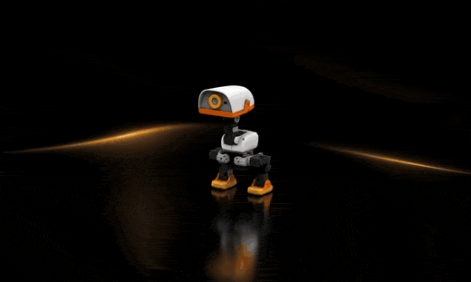
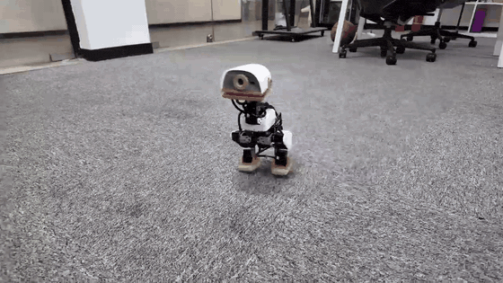
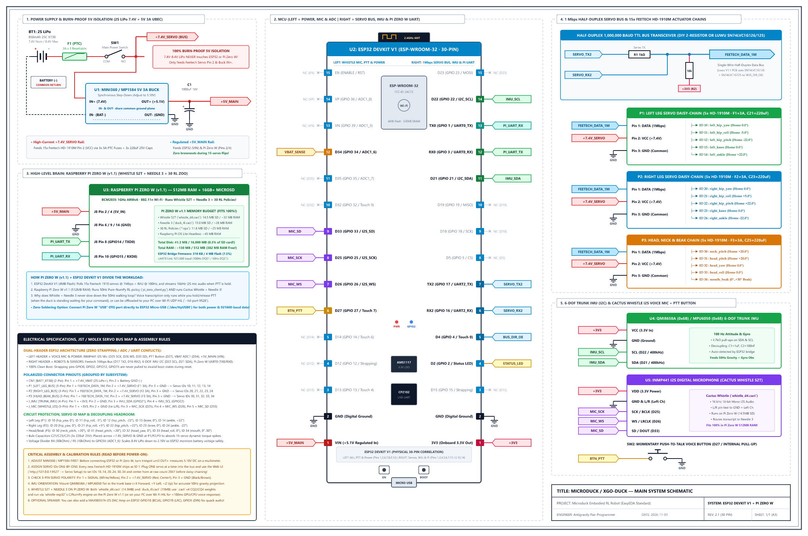

# 🦆 Microduck / XGO-Duck Embodied AI Suite

<p align="center">
  
  
</p>

An end-to-end **Embodied AI, MuJoCo Physics Simulation, Hardware-in-the-Loop (HIL), Voice-to-Action, and Custom Electronics** repository for building and running the **15-DoF Microduck / XGO-Duck** bipedal robot using:

- **High-Level Compute:** **Raspberry Pi Zero W (v1.1 / Zero 2 W)** (`512 MB RAM`, runs all 29 RL policies in Pure-NumPy `.npz` at 50 Hz without requiring `onnxruntime`)
- **Real-Time MCU & Built-in Servo Programmer:** **ESP32** (`DevKit V1`, `ESP32-S2 Mini`, `ESP32-C3 Pro Mini`, `ESP32-H2 Mini`, or `LOLIN32 Lite`) driving 15× **Feetech HD-1910-C001 (`7.4V–8.4V`)** TTL serial bus servos at `1,000,000` baud + `100 Hz` 6-axis IMU (`QMI8658A` / `MPU6050`)
- **Voice-to-Action Brain (~98 ms total latency):** **Cactus Whistle S2T** (`whistle_d4.cact`) speech-to-text + **Cactus Needle 3** (`duck_4l.cact`) *"The Polite Duck"* function-calling brain (refuses and shakes its head `"NO"` if you don't say *"please"*!)
- **30-Skill RL Policy Zoo:** 29 distinct Reinforcement Learning neural networks covering omnidirectional walking, running, 2m sprint, roller-skating, somersault (`roulade`), **explosive backflips**, Michael Jackson moonwalk, groove/rave dances, headstands, one-legged flamingo balance, polite bow, and soccer kicks.

---

## 📐 Full Hardware Schematic (EasyEDA Standard A3)

<p align="center">
  
</p>

- **Interactive Browser Viewer:** [`diagrams/Microduck_EasyEDA_Interactive.html`](diagrams/Microduck_EasyEDA_Interactive.html)
- **Vector SVG & EasyEDA JSON:** [`diagrams/Microduck_PiZeroW_ESP32_EasyEDA.svg`](diagrams/Microduck_PiZeroW_ESP32_EasyEDA.svg) | [`diagrams/Microduck_PiZeroW_ESP32_EasyEDA.json`](diagrams/Microduck_PiZeroW_ESP32_EasyEDA.json)
- **Complete Build & Wiring Guide:** [`docs/BUILD_AND_WIRING_GUIDE.md`](docs/BUILD_AND_WIRING_GUIDE.md)

---

## 🗂️ Repository Directory Structure

```text
Microduck/
├── src/                                  # Core Python Runtime, Simulator, Web UI, S2T & Needle 3
│   ├── xgoduck_sim_and_hil.py            # Main MuJoCo Simulator + Web UI (:9527) + HIL UDP (:9528)
│   ├── policy_zoo.py                     # 30-Skill RL Policy Zoo & Cactus Needle 3 Router
│   ├── whistle_stt.py                    # Cactus Whistle Speech-to-Text (S2T) Engine
│   ├── numpy_policy.py                   # Pure-NumPy MLP inference engine (0.08 ms PC / 1.8 ms Pi Zero W)
│   └── pi_zero_w_runtime/
│       └── pi_zero_client.py             # Standalone 50 Hz RL + HIL client for Raspberry Pi Zero W (v1.1)
│
├── firmware/                             # Microcontroller Flashes / Sketches
│   ├── esp32_xgoduck_bridge/
│   │   └── esp32_xgoduck_bridge.ino      # Multi-ESP32 100 Hz Servo/IMU Bridge + Built-In Feetech Programmer
│   └── uno_q_reference/                  # Reference Arduino Uno Q Zephyr sketch & protocol headers
│
├── 3d_models/                            # 3D Printable STLs, TPU Parts & 3MF Plates
│   ├── xgoduck_v2_structure_stls/        # Official named XGO-Duck V2 STLs (body, head, legs, TPU feet/beak, tires)
│   ├── xgoduck_v2_numbered_stls/         # Numbered XGO-Duck V2 kit STL set
│   └── microduck_print_plate.3mf         # Multi-plate 3MF print project
│
├── ml_checkpoints/                       # Machine Learning Models & Weights
│   ├── models_npz/                       # All 29 RL policies exported to lightweight Pure-NumPy (.npz)
│   ├── onnx_core/                        # Core XGO-Duck & Microduck ONNX policies (walk, getup, kick, roulade, etc.)
│   ├── hf_zoo/                           # 20 Hugging Face Community & Pollen Robotics RL ONNX policies
│   ├── cactus_needle/                    # Needle 3 Polite Duck tool-calling weights (duck_4l.cact, 10.7 MB)
│   └── cactus_whistle/                   # Cactus Whistle S2T weights (whistle_d4.cact, 14.5 MB & whistle.cact)
│
├── simulation/                           # MuJoCo MJCF Scenes, Collision Meshes & Actuator Physics
│   ├── xgoduck_mjcf/                     # XGO-Duck scene.xml, robot_allcollisions.xml, and STL meshes
│   ├── microduck_mjcf/                   # Original Microduck MJCF & URDF models
│   └── bam_actuator/                     # BAM Feetech HD-1910M (1910_m6.json) Stribeck & voltage-drop model
│
├── diagrams/                             # Hardware Schematics & PCBA Layouts
│   ├── Microduck_PiZeroW_ESP32_EasyEDA.* # Pure-white A3 30-Pin EasyEDA Schematic (PNG, SVG, JSON, HTML)
│   └── reference_pcba/                   # Official XGO-Duck PCBA schematics, BOM & silkscreen layouts
│
├── tools/                                # Build, Conversion, Schematic & Calibration Utilities
│   ├── export_onnx_to_numpy.py           # Converts & verifies all 29 .onnx policies -> .npz
│   ├── generate_easyeda_schematic.py     # Generates the A3 EasyEDA schematic SVG/PNG/JSON/HTML
│   ├── bno08x_calibrate_ui.py            # IMU mounting orientation calibration tool
│   └── whistle_tools/                    # Cactus Whistle layer stripper (whistle_strip.py) & NumPy ref
│
├── results/                              # Verification Benchmarks & Test Reports
│   ├── whistle_needle_e2e_benchmark.md   # End-to-end Voice -> Whistle -> Needle 3 -> MuJoCo latency report
│   └── policy_export_verification.json   # Numerical accuracy & latency metrics for all 29 .npz models
│
├── docs/                                 # Documentation, Assembly Manual, BOM & Media
│   ├── BUILD_AND_WIRING_GUIDE.md         # Step-by-step Pi Zero W + ESP32 + Feetech 1910 build guide
│   ├── Assembly_Guide.pdf                # Official visual mechanical assembly manual
│   ├── BOM.md / PRINTING.md / FAQ.md     # Hardware bill of materials, 3D print settings & troubleshooting
│   └── media/                            # Robot photos, print orientation reference & GIFs
│
└── vendor/                               # Cleanly Vendored Upstream Reference Packages
    ├── xgoduck_runtime_arduino/
    ├── xgoduck_rl/
    ├── needle-duck/
    ├── whistle-esp32/
    └── Microduck-build-tutorial/
```

---

## 🚀 Quickstart

### 1. Launch the Unified MuJoCo 3D Simulator + Web UI + Voice Control
Double-click [`run_simulator.bat`](run_simulator.bat) or run:
```powershell
python src/xgoduck_sim_and_hil.py --numpy-policy
```
- **MuJoCo 3D Viewer:** Opens automatically with real-time 50 Hz RL physics (`1910_m6.json` BAM actuator model).
- **Web UI (`http://127.0.0.1:9527`):** Includes walk joysticks, skill buttons, **`🎙️ Hold to Speak` Whistle S2T voice button**, **30-Skill RL Policy Zoo**, and **Feetech 1910 Servo ID / Center Calibration Programmer**.
- **Terminal CLI:** Type natural language commands (`Please do a backflip`, `Please moonwalk`, `voice` to record from your microphone, or `zoo` to list all 30 RL policies).

### 2. Run the Automated End-to-End Voice & RL Verification Suite
```powershell
# Verify Cactus Whistle S2T + Needle 3 Polite Gate + MuJoCo 50 Hz RL Zoo
python src/xgoduck_sim_and_hil.py --whistle-test

# Re-export and verify all 29 ONNX policies to Pure-NumPy .npz
python tools/export_onnx_to_numpy.py
```

---

## 🔩 Servo ID Map (`Feetech HD-1910-C001` @ `1,000,000` Baud TTL)

> **No external `FE-URT-2` programmer needed!** Flash [`firmware/esp32_xgoduck_bridge/esp32_xgoduck_bridge.ino`](firmware/esp32_xgoduck_bridge/esp32_xgoduck_bridge.ino) onto your ESP32 and use the Web UI (`http://127.0.0.1:9527`) to assign IDs (`1 -> 10..34`) and electronically calibrate center (`2047`).

| Body Group | Qty | Servo IDs | Joint Names |
| :--- | :-: | :--- | :--- |
| **Left Leg** | 5 | `10, 11, 12, 13, 14` | `left_hip_yaw`, `left_hip_roll`, `left_hip_pitch`, `left_knee`, `left_ankle` |
| **Right Leg** | 5 | `20, 21, 22, 23, 24` | `right_hip_yaw`, `right_hip_roll`, `right_hip_pitch`, `right_knee`, `right_ankle` |
| **Neck & Head** | 4 | `30, 31, 32, 33` | `neck_pitch` (lower), `head_pitch` (upper), `head_roll`, `head_yaw` |
| **Beak / Mouth** | 1 *(Optional)* | `34` | `mouth` (motorized quacking jaw, `0°–30°`) |

---

## 📜 License & Acknowledgements
Licensed under the [Apache-2.0 License](LICENSE). Built upon the open-source work of **Pollen Robotics**, **LuwuDynamics**, **Antoine Pirrone**, **AI-FanGe**, and **Cactus Compute**.

