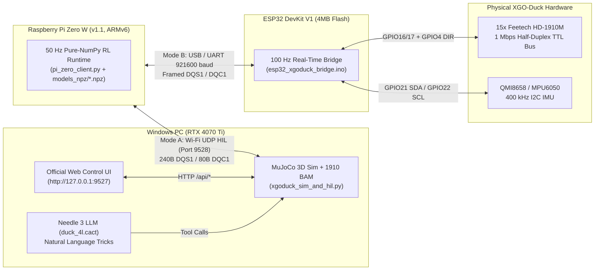

# XGO-Duck / Microduck Complete Simulation, RL, HIL & Hardware Build Guide

> [!IMPORTANT]
> **Hardware Match Summary:** Your Alibaba motor link (**15× Feetech HD-1910M / 1910** coreless TTL serial bus servos, 7.4V–8.4V 2S Li-ion) directly matches the **LuwuDynamics XGO-Duck V2** (`xgoduck_hardware-master/structure/` and `XGO_duckV2_stls/`). By contrast, `AI-FanGe/Microduck-build-tutorial` uses Dynamixel XL330-M288-T (5V) servos with different mounting dimensions. **Print the STLs from [xgoduck_hardware-master/structure](file:///d:/3D%20Prints/Microduck/xgoduck_hardware-master/structure) or [XGO_duckV2_stls](file:///d:/3D%20Prints/Microduck/XGO_duckV2_stls)** for your Feetech 1910 servos.

---

## 1. Architecture Overview: Replacing Arduino Uno Q / Pi Zero 2W with Pi Zero W (v1.1) + ESP32 DevKit V1

Because the **Raspberry Pi Zero W (v1.1)** uses a 32-bit ARMv6 CPU (`armv6l`, 1 GHz single-core, 512 MB RAM):
1. It **cannot boot** 64-bit (`arm64`) Raspberry Pi OS images (`microduck.img.xz`).
2. It **has no official `onnxruntime` wheels** for `armv6l`.

We solved both constraints cleanly in [xgoduck_embodied_suite](file:///d:/3D%20Prints/Microduck/xgoduck_embodied_suite):
- **ONNX-Free Pure-NumPy Inference Engine ([numpy_policy.py](file:///d:/3D%20Prints/Microduck/xgoduck_embodied_suite/numpy_policy.py)):** Extracted all 9 ONNX policies (`61 -> 512 -> 256 -> 128 -> 14` with `ELU` and observation normalization) into compact `.npz` files in [models_npz](file:///d:/3D%20Prints/Microduck/xgoduck_embodied_suite/models_npz) (~710 KB each, `0.099–0.164 ms` inference latency). Only `python3-numpy` is required on the Pi Zero W (v1.1).
- **Split-Compute Real-Time Architecture:**
  - **Raspberry Pi Zero W (v1.1):** Runs 32-bit Raspberry Pi OS Lite (`armhf`), executes the 50 Hz RL policy loop ([pi_zero_client.py](file:///d:/3D%20Prints/Microduck/xgoduck_embodied_suite/pi_zero_w_runtime/pi_zero_client.py)), and hosts Wi-Fi/SSH telemetry.
  - **ESP32 DevKit V1 (4 MB Flash):** Runs [esp32_xgoduck_bridge.ino](file:///d:/3D%20Prints/Microduck/xgoduck_embodied_suite/esp32_xgoduck_bridge/esp32_xgoduck_bridge.ino), handling deterministic 100 Hz I2C IMU sampling (`QMI8658` or `MPU6050`) and 1 Mbps `SYNC_WRITE` / round-robin feedback on the 15× Feetech 1910 servo bus. Includes `AUTO_EMULATE_MISSING_HARDWARE 1` so you can test the bare ESP32 + Pi Zero W (v1.1) on your desk today before your servos arrive.



---

## 2. Verified Simulation & HIL Suite Commands

All Python dependencies (`mujoco`, `onnx`, `onnxruntime`, `numpy`, `better-actuator-models`, `fastapi`, `uvicorn`, `cactus-needle`, `pyserial`) are installed in:
`d:\3D Prints\Microduck\Microduck-build-tutorial-main\Microduck-build-tutorial-main\microduck\.venv`

### A. Launch the Unified XGO-Duck 3D MuJoCo Simulator + Web UI + Needle 3 + HIL Server
Runs the full XGO-Duck V2 robot with the calibrated **Feetech 1910 BAM actuator model** ([1910_m6.json](file:///d:/3D%20Prints/Microduck/xgoduck_rl/src/mjlab_microduck/robot/xgoduck/params/1910_m6.json)), all 8 pure-NumPy `.npz` skills, the official browser control UI at http://127.0.0.1:9527, Needle 3 (`duck_4l.cact`) polite natural-language control in the terminal, and the UDP HIL server on port `9528`:
```powershell
& "d:\3D Prints\Microduck\Microduck-build-tutorial-main\Microduck-build-tutorial-main\microduck\.venv\Scripts\python.exe" "d:\3D Prints\Microduck\xgoduck_embodied_suite\xgoduck_sim_and_hil.py"
```
- **In your browser:** Open http://127.0.0.1:9527 to drive velocity/head pose, toggle Roller mode, or click **Pick**, **Roulade (Somersault)**, **Sit/Stand**, **Left Kick**, and **Right Kick**.
- **In the terminal:** Type natural-language commands (remember to say *"please"*!):
  - `please walk forward`
  - `do a somersault please`
  - `kick right please`
  - `pick please`
  - `sit please` / `stand please`
  - `walk forward` *(without "please" — the duck refuses and shakes its head!)*

### B. Run Automated Headless Multi-Skill & UDP HIL Verification
```powershell
# Verify all 7 XGO-Duck skills (Stand, Walk, Kick, Sit/Stand, Pick, Somersault/Roulade, Getup Fall Recovery)
& "d:\3D Prints\Microduck\Microduck-build-tutorial-main\Microduck-build-tutorial-main\microduck\.venv\Scripts\python.exe" "d:\3D Prints\Microduck\xgoduck_embodied_suite\xgoduck_sim_and_hil.py" --headless-test

# Verify end-to-end UDP Hardware-in-the-Loop (HIL) with pi_zero_client.py driving MuJoCo
& "d:\3D Prints\Microduck\Microduck-build-tutorial-main\Microduck-build-tutorial-main\microduck\.venv\Scripts\python.exe" "d:\3D Prints\Microduck\xgoduck_embodied_suite\xgoduck_sim_and_hil.py" --hil-test
```

### C. Run `needle-duck` ("The Polite Duck" Open Duck Mini v2 Simulator)
```powershell
cd "d:\3D Prints\Microduck\needle-duck"
& "d:\3D Prints\Microduck\Microduck-build-tutorial-main\Microduck-build-tutorial-main\microduck\.venv\Scripts\python.exe" duck_needle.py --weights models/duck_4l.cact
```

### D. Run `AI-FanGe/Microduck-build-tutorial` MuJoCo Simulator
```powershell
cd "d:\3D Prints\Microduck\Microduck-build-tutorial-main\Microduck-build-tutorial-main\microduck"
& ".\.venv\Scripts\python.exe" mujoco_test.py
```

---

## 3. Running HIL Emulation on Your Raspberry Pi Zero W (v1.1) & ESP32 DevKit V1 Today

### Step 1: Flash the ESP32 DevKit V1 (4 MB Flash)
1. Open [esp32_xgoduck_bridge.ino](file:///d:/3D%20Prints/Microduck/xgoduck_embodied_suite/esp32_xgoduck_bridge/esp32_xgoduck_bridge.ino) in Arduino IDE (or PlatformIO) with board set to **ESP32 Dev Module**.
2. Leave `#define AUTO_EMULATE_MISSING_HARDWARE 1` enabled (default).
3. Flash to your ESP32 DevKit V1 over micro-USB. Even with **zero servos or IMU wired**, the ESP32 will immediately run its 100 Hz control loop and emulate smooth servo/IMU physics on your desk.

### Step 2: Set Up Your Raspberry Pi Zero W (v1.1)
1. Flash **Raspberry Pi OS Lite (32-bit, `armhf` Bookworm)** using Raspberry Pi Imager (configure Wi-Fi and SSH in Imager settings).
2. Install only `numpy` and `pyserial`:
   ```bash
   sudo apt update && sudo apt install -y python3-numpy python3-serial
   ```
3. Copy the lightweight runtime folder to the Pi Zero W:
   ```powershell
   scp -r "d:\3D Prints\Microduck\xgoduck_embodied_suite" pi@<PI_ZERO_IP>:~/
   ```
4. **Run Mode A (Wi-Fi UDP HIL driving your PC's 3D MuJoCo simulator from the physical Pi Zero W v1.1):**
   ```bash
   python3 ~/xgoduck_embodied_suite/pi_zero_w_runtime/pi_zero_client.py --hil-udp <YOUR_PC_LAN_IP>:9528
   ```
5. **Run Mode B (Pi Zero W v1.1 driving the physical ESP32 DevKit V1 over USB/UART at 921600 baud):**
   ```bash
   python3 ~/xgoduck_embodied_suite/pi_zero_w_runtime/pi_zero_client.py --esp32-serial /dev/ttyUSB0
   ```

---

## 4. Reinforcement Learning (`xgoduck_rl` / `mjlab`) on Your RTX 4070 Ti (12 GB VRAM)

The official LuwuDynamics RL repository is cloned at [xgoduck_rl](file:///d:/3D%20Prints/Microduck/xgoduck_rl) and uses `mjlab==1.3.0` + `warp-lang==1.12.0` + `better-actuator-models` (`1910_m6.json`).

### Setup & Training Commands
```powershell
cd "d:\3D Prints\Microduck\xgoduck_rl"
$env:PATH = "$HOME\.local\bin;" + $env:PATH

# Create/sync the dedicated RL training environment (Python 3.12 + PyTorch CUDA 12.9 + Warp)
uv sync

# Train XGO-Duck Flat Velocity Walking on RTX 4070 Ti
uv run train Mjlab-Velocity-Flat-XgoDuck

# Train XGO-Duck Dynamic Tricks & Skills
uv run train Mjlab-Roulade-Flat-XgoDuck          # Forward somersault
uv run train Mjlab-BallKick-Flat-XgoDuck         # Right-foot ball kick
uv run train Mjlab-BallKick-Left-Flat-XgoDuck    # Left-foot ball kick
uv run train Mjlab-GroundPick-Flat-XgoDuck       # Crouch & pick with beak
uv run train Mjlab-SitStand-Flat-XgoDuck         # Gentle Sit <-> Stand
uv run train Mjlab-StandUp-Flat-XgoDuck          # Fall recovery (get-up from back/side)

# Play/Visualize the latest trained checkpoint in MuJoCo
uv run play Mjlab-Velocity-Flat-XgoDuck
```
Whenever you export a new `.onnx` policy from `xgoduck_rl`, convert it for the Raspberry Pi Zero W (v1.1) by running:
```powershell
& "d:\3D Prints\Microduck\Microduck-build-tutorial-main\Microduck-build-tutorial-main\microduck\.venv\Scripts\python.exe" "d:\3D Prints\Microduck\xgoduck_embodied_suite\export_onnx_to_numpy.py"
```

---

## 5. Hardware BOM, Servo ID Map, 3D Print Inventory & Wiring Schematic

### A. Bill of Materials (BOM) Checklist
| Category | Component | Qty | Notes / Specification |
| :--- | :--- | :---: | :--- |
| **Actuators** | **Feetech HD-1910M (1910)** Coreless Serial Bus Servo | **15** | Matches your Alibaba Microduck Kit (`34 × 20 × 23 mm`, 7.4V, 1 Mbps TTL bus) |
| **Compute (High-Level)** | **Raspberry Pi Zero W (v1.1)** + MicroSD (16GB+) | 1 | Already in your hand |
| **Compute (Real-Time)** | **ESP32 DevKit V1 (4 MB Flash)** | 1 | Already in your hand |
| **IMU Sensor** | **QMI8658** (`0x6A`/`0x6B`) or **MPU6050** (`0x68`/`0x69`) breakout | 1 | Mounted flat in trunk (`+X` forward, `+Y` left, `+Z` up) |
| **Battery** | **2S 18650 Li-ion Pack (7.4V nominal / 8.4V max)** | 1 | Powers the 15× Feetech 1910 servos directly (`VDD_SERVO`) |
| **5V Buck Converter** | **DC-DC Step-Down (7.4V → 5.0V, ≥3A)** | 1 | Powers Raspberry Pi Zero W (`5V` pin) and ESP32 (`VIN`/`5V` pin) |
| **Half-Duplex Bus Resistor** | **1 kΩ – 2.2 kΩ Resistor** (or 74HC126 buffer) | 1 | Bridges ESP32 `TX2 (GPIO17)` and `RX2 (GPIO16)` onto the single-wire `DATA` line |
| **Bearings** | **MR63ZZ** (`3×6×2.5 mm`) or frame-specified flange bearings | 15 | Opposing pivot support for each joint |
| **Fasteners** | **M2 × 6 mm, M2 × 8 mm, M2 × 12 mm** screws + M2 brass heat-set inserts | 1 kit | Standard XGO-Duck V2 assembly hardware |

---

### B. Complete 15-Servo ID & Home Pose Table (`MOTOR_IDS` Order)
Program each Feetech 1910 servo ID **one at a time** before daisy-chaining (using the Web UI's `Servo Debug` tab or Feetech FD debug software), and center all horns at raw encoder count `2047` (`0°`):

| Index | Servo ID | Joint Name (MJCF) | Subsystem | Default Standing Angle (`DEFAULT_DEG`) |
| :---: | :---: | :--- | :--- | :---: |
| 0 | **10** | `left_hip_yaw` | Left Leg | `0.0°` |
| 1 | **11** | `left_hip_roll` | Left Leg | `-5.0°` |
| 2 | **12** | `left_hip_pitch` | Left Leg | `-22.0°` |
| 3 | **13** | `left_knee` | Left Leg | `0.0°` |
| 4 | **14** | `left_ankle` | Left Leg | `+22.0°` |
| 5 | **20** | `right_hip_yaw` | Right Leg | `0.0°` |
| 6 | **21** | `right_hip_roll` | Right Leg | `+5.0°` |
| 7 | **22** | `right_hip_pitch` | Right Leg | `+22.0°` |
| 8 | **23** | `right_knee` | Right Leg | `0.0°` |
| 9 | **24** | `right_ankle` | Right Leg | `-22.0°` |
| 10 | **30** | `neck_pitch` | Neck / Head | `+20.0°` |
| 11 | **31** | `head_pitch` | Neck / Head | `+20.0°` |
| 12 | **32** | `head_yaw` | Neck / Head | `0.0°` |
| 13 | **33** | `head_roll` | Neck / Head | `0.0°` |
| 14 | **34** | `mouth` (Beak) | Beak | `0.0°` (`0°` closed → `30°` open) |

---

### C. EasyEDA Standard A3 Schematic Diagram & Interactive Wiring Viewer


We generated four ready-to-use schematic files in [hardware_schematic](file:///d:/3D%20Prints/Microduck/xgoduck_embodied_suite/hardware_schematic):
1. **High-Resolution A3 Schematic PNG ([Microduck_PiZeroW_ESP32_EasyEDA.png](file:///d:/3D%20Prints/Microduck/xgoduck_embodied_suite/hardware_schematic/Microduck_PiZeroW_ESP32_EasyEDA.png)) & Vector SVG ([Microduck_PiZeroW_ESP32_EasyEDA.svg](file:///d:/3D%20Prints/Microduck/xgoduck_embodied_suite/hardware_schematic/Microduck_PiZeroW_ESP32_EasyEDA.svg))** — matching the exact 30-pin `ESP32 DevKit V1` physical pinout & net-flag schematic style.
2. **Interactive Zoomable Schematic App ([Microduck_EasyEDA_Interactive.html](file:///d:/3D%20Prints/Microduck/xgoduck_embodied_suite/hardware_schematic/Microduck_EasyEDA_Interactive.html)):**
   - Open [Microduck_EasyEDA_Interactive.html](file:///d:/3D%20Prints/Microduck/xgoduck_embodied_suite/hardware_schematic/Microduck_EasyEDA_Interactive.html) in any browser (or visit `http://127.0.0.1:9527/schematic` while [xgoduck_sim_and_hil.py](file:///d:/3D%20Prints/Microduck/xgoduck_embodied_suite/xgoduck_sim_and_hil.py) is running).
3. **EasyEDA Standard Schematic JSON ([Microduck_PiZeroW_ESP32_EasyEDA.json](file:///d:/3D%20Prints/Microduck/xgoduck_embodied_suite/hardware_schematic/Microduck_PiZeroW_ESP32_EasyEDA.json)):**
   - Open https://easyeda.com/editor → **File → Open → EasyEDA...** and select [Microduck_PiZeroW_ESP32_EasyEDA.json](file:///d:/3D%20Prints/Microduck/xgoduck_embodied_suite/hardware_schematic/Microduck_PiZeroW_ESP32_EasyEDA.json).

| Connection Group | ESP32 DevKit V1 Pin | Target Pin / Bus | EasyEDA / Luwu V1.1 PCBA Notes |
| :--- | :--- | :--- | :--- |
| **Feetech 1910 Bus Data (`1 Mbps`)** | `GPIO16 (RX2)` + `GPIO17 (TX2)` | Servo Header **Pin 1 (`SIGNAL`)** | **DIY:** Connect `GPIO16` directly to `SIGNAL`, `GPIO17` through `R1 = 1 kΩ` to `SIGNAL`, plus `R2 = 10 kΩ` pull-up to `3.3V`. **PCB:** `SN74LVC1G126` (`SN1`) + `SN74LVC1G125` (`SN2`). |
| **Feetech 1910 Power (`+7.4V_VBAT`)** | `GND` (Common Ground) | Servo Header **Pin 2 (`VCC`)** & **Pin 3 (`GND`)** | **Never** power `VCC_SERVO` from the ESP32/Pi `5V` pin. Feed Pin 2 directly from the 2S LiPo (`7.4V–8.4V`) via a `3A` PPTC fuse (`SMD2920P300TF/15`) and `220 µF / 25V` bulk capacitor per branch (`P1` Left Leg, `P2` Right Leg, `P3` Head/Beak). |
| **5V Logic Buck (`+5V_BUCK`)** | `VIN` (`5V` Pin) & `GND` | Pi Zero W **Pin 2/4 (`5V`)** & **Pin 6 (`GND`)** | Powered by a `5.1V @ 3A` synchronous buck regulator (`TPS566238RQFR` or `MP1584EN`) stepped down from `+7.4V_VBAT`. |
| **I2C IMU (`QMI8658A`/`MPU6050`)** | `GPIO21 (SDA)`, `GPIO22 (SCL)`, `3V3`, `GND` | IMU `SDA`, `SCL`, `VCC`, `GND` | Auto-detected at boot (`0x6A`/`0x6B` for QMI8658A, `0x68`/`0x69` for MPU6050) with `4.7 kΩ` pull-ups to `3.3V`. |
| **INMP441 I²S Mic (`Block 5B`, Whistle S2T)** | `GPIO25 (SCK)`, `GPIO26 (WS)`, `GPIO33 (SD)`, `GPIO27 (PTT)` | `INMP441` `SCK`, `WS`, `SD`, `VDD->3.3V`, `GND/L/R->GND` | Streams 16 kHz mono I²S audio when Push-to-Talk (`GPIO27` to `GND`) is held (or `GPIO4/5/6/7` on ESP32-S3 N16R8 for standalone on-chip `whistle-esp32`). |
| **Pi Zero W ↔ ESP32 Link (`921600` baud)** | `RX0 (GPIO3)`, `TX0 (GPIO1)` **or** Micro-USB | Pi **Pin 8 (`GPIO14 TX`)**, **Pin 10 (`GPIO15 RX`)** **or** USB OTG | Streams 100 Hz `DQS1` (240 B) and 50 Hz `DQC1` (80 B) packets with `[0xA5, 0x5A, type, len, payload, crc8]` framing. |

---

### D. 3D Printing Inventory ([xgoduck_hardware-master/structure](file:///d:/3D%20Prints/Microduck/xgoduck_hardware-master/structure) & [XGO_duckV2_stls](file:///d:/3D%20Prints/Microduck/XGO_duckV2_stls))

Recommended slicer settings for PETG or PLA+: **0.20 mm layer height, 3–4 wall loops, 25–30% gyroid infill**.

| Subsystem | STL Files in [xgoduck_hardware-master/structure](file:///d:/3D%20Prints/Microduck/xgoduck_hardware-master/structure) | Material Recommendation |
| :--- | :--- | :--- |
| **Trunk / Torso** | [body_front.STL](file:///d:/3D%20Prints/Microduck/xgoduck_hardware-master/structure/body_front.STL), [body_middle.STL](file:///d:/3D%20Prints/Microduck/xgoduck_hardware-master/structure/body_middle.STL), [body_back.STL](file:///d:/3D%20Prints/Microduck/xgoduck_hardware-master/structure/body_back.STL), [battery_stopper.STL](file:///d:/3D%20Prints/Microduck/xgoduck_hardware-master/structure/battery_stopper.STL), [switch.STL](file:///d:/3D%20Prints/Microduck/xgoduck_hardware-master/structure/switch.STL), [tail_left.STL](file:///d:/3D%20Prints/Microduck/xgoduck_hardware-master/structure/tail_left.STL), [tail_right.STL](file:///d:/3D%20Prints/Microduck/xgoduck_hardware-master/structure/tail_right.STL) | PLA+ or PETG |
| **Left Leg** | [leg_1.STL](file:///d:/3D%20Prints/Microduck/xgoduck_hardware-master/structure/leg_1.STL), [leg_2.STL](file:///d:/3D%20Prints/Microduck/xgoduck_hardware-master/structure/leg_2.STL), [leg_left_3.STL](file:///d:/3D%20Prints/Microduck/xgoduck_hardware-master/structure/leg_left_3.STL), [leg_4.STL](file:///d:/3D%20Prints/Microduck/xgoduck_hardware-master/structure/leg_4.STL), [foot_left.STL](file:///d:/3D%20Prints/Microduck/xgoduck_hardware-master/structure/foot_left.STL), [foot_left_sole.STL](file:///d:/3D%20Prints/Microduck/xgoduck_hardware-master/structure/foot_left_sole.STL) | PETG / Tough PLA for links; **TPU 95A** for `foot_left_sole.STL` |
| **Right Leg** | [leg_1.STL](file:///d:/3D%20Prints/Microduck/xgoduck_hardware-master/structure/leg_1.STL), [leg_2.STL](file:///d:/3D%20Prints/Microduck/xgoduck_hardware-master/structure/leg_2.STL), [leg_right_3.STL](file:///d:/3D%20Prints/Microduck/xgoduck_hardware-master/structure/leg_right_3.STL), [leg_4.STL](file:///d:/3D%20Prints/Microduck/xgoduck_hardware-master/structure/leg_4.STL), [foot_right.STL](file:///d:/3D%20Prints/Microduck/xgoduck_hardware-master/structure/foot_right.STL), [foot_right_sole.STL](file:///d:/3D%20Prints/Microduck/xgoduck_hardware-master/structure/foot_right_sole.STL) | PETG / Tough PLA for links; **TPU 95A** for `foot_right_sole.STL` |
| **Neck & Head** | [neck.STL](file:///d:/3D%20Prints/Microduck/xgoduck_hardware-master/structure/neck.STL), [head_front.STL](file:///d:/3D%20Prints/Microduck/xgoduck_hardware-master/structure/head_front.STL), [head_back.STL](file:///d:/3D%20Prints/Microduck/xgoduck_hardware-master/structure/head_back.STL), [head_left.STL](file:///d:/3D%20Prints/Microduck/xgoduck_hardware-master/structure/head_left.STL), [head_right.STL](file:///d:/3D%20Prints/Microduck/xgoduck_hardware-master/structure/head_right.STL), [mouth_up.STL](file:///d:/3D%20Prints/Microduck/xgoduck_hardware-master/structure/mouth_up.STL), [mouth_down.STL](file:///d:/3D%20Prints/Microduck/xgoduck_hardware-master/structure/mouth_down.STL), [eye_left.STL](file:///d:/3D%20Prints/Microduck/xgoduck_hardware-master/structure/eye_left.STL), [eye_right.STL](file:///d:/3D%20Prints/Microduck/xgoduck_hardware-master/structure/eye_right.STL) | PLA+ (Yellow/Orange for beak, White/Black for eyes) |
| **Roller / Skates Add-on** | [wheel_1.STL](file:///d:/3D%20Prints/Microduck/xgoduck_hardware-master/structure/wheel_1.STL), [wheel_2.STL](file:///d:/3D%20Prints/Microduck/xgoduck_hardware-master/structure/wheel_2.STL), [wheel_3.STL](file:///d:/3D%20Prints/Microduck/xgoduck_hardware-master/structure/wheel_3.STL), [wheel_holder_left.STL](file:///d:/3D%20Prints/Microduck/xgoduck_hardware-master/structure/wheel_holder_left.STL), [wheel_holder_right.STL](file:///d:/3D%20Prints/Microduck/xgoduck_hardware-master/structure/wheel_holder_right.STL) | Optional roller-skating feet for `xgoduck_roller.npz` |

---

## 6. Cactus Whistle S2T (`whistle_d4.cact`) + Needle 3 (`duck_4l.cact`) Voice Pipeline

Both **Whistle** (`Cactus-Compute/whistle`, speech-to-text) and **Needle 3** (`andrisgauracs/needle-duck`, tool calling) come from **Cactus Compute** (`cactus-needle==3.2.10`) and share the exact same **Needle 3 `.cact` v4 (`0x05E12A84`)** architecture:
- **Hadamard / Monarch Kronecker MLPs** (`16×32` factors + fixed random permutations)
- **mHC Multi-Lane Sinkhorn Residual Mixing**
- **N-Gram Engram Tables** (`0x9E3779B9` FNV-style token n-gram hash)

### How to Use Voice Control in [xgoduck_sim_and_hil.py](file:///d:/3D%20Prints/Microduck/xgoduck_embodied_suite/xgoduck_sim_and_hil.py)
1. **In the Browser Web UI (`http://127.0.0.1:9527`):**
   - Click **`🦆 Needle 3 + Whistle S2T + 30 RL Policies`** in the bottom-right corner.
   - Press and hold **`🎙️ Hold to Speak`**, say *"Please do a backflip"* or *"Please moonwalk"*, and release!
   - The browser captures 16 kHz mono PCM WAV audio and posts it to `POST /api/whistle`, where **Cactus Whistle (`whistle_d4.cact`)** transcribes it in **~40–75 ms** (`~300+ tok/s`) and **Needle 3 (`duck_4l.cact`)** routes it to the matching 50 Hz RL policy in **~45–60 ms**.
2. **In the Terminal:**
   - Type `voice` (or `ptt`) and press Enter to record 3 seconds from your Windows microphone via [record_windows_mic_wav](file:///d:/3D%20Prints/Microduck/xgoduck_embodied_suite/whistle_stt.py#L228-L265), transcribe with Whistle, and execute via Needle 3.
   - Type `whistle <path/to/clip.wav>` to transcribe any `.wav` file and execute the command.
3. **Automated Voice-to-Action Verification (`--whistle-test`):**
   ```powershell
   & "d:\3D Prints\Microduck\Microduck-build-tutorial-main\Microduck-build-tutorial-main\microduck\.venv\Scripts\python.exe" "d:\3D Prints\Microduck\xgoduck_embodied_suite\xgoduck_sim_and_hil.py" --whistle-test
   ```
